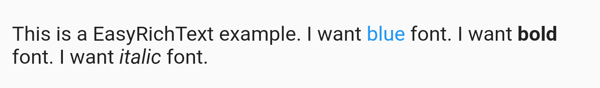
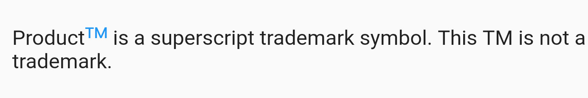
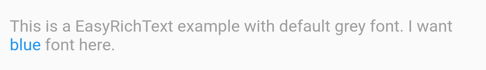
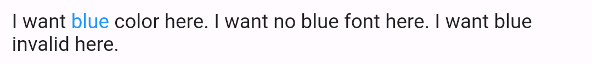
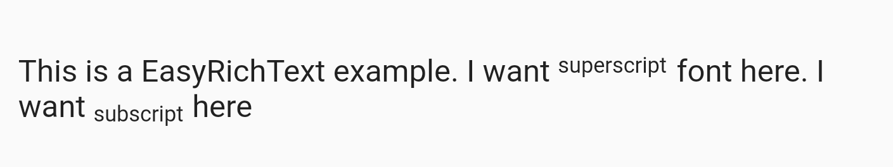
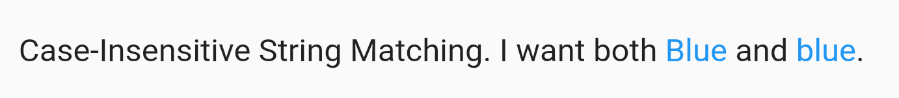
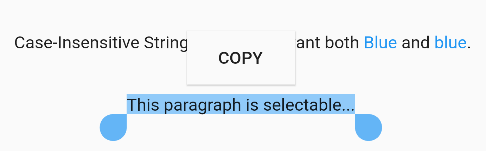
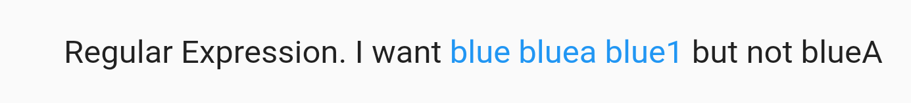
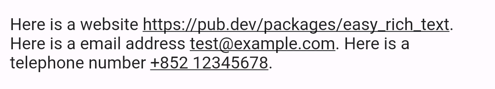
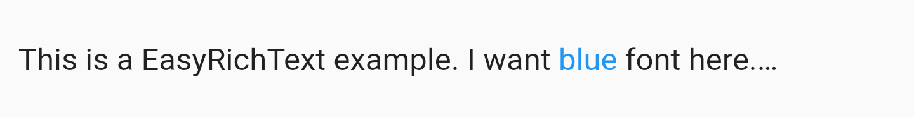

# easy_rich_text

[](https://pub.dev/packages/easy_rich_text) [](https://github.com/2000calories/flutter_easy_rich_text/blob/master/LICENSE) [](https://github.com/2000calories/flutter_easy_rich_text/stargazers)

El widget `EasyRichText` hace que el widget RichText sea sencillo. No tienes que dividir la cadena de texto manualmente.

Este widget utiliza expresiones regulares para dividir eficazmente la cadena basándose en los patrones definidos en la lista de `EasyRichTextPattern`.

`EasyRichTextPattern` es una clase que define el patrón de texto que deseas formatear.

`targetString` puede ser un `String` o una `List<String>`.

Por defecto, `matchWordBoundaries:true` está configurado para coincidir con la palabra completa. Si deseas coincidir con una subcadena dentro de una palabra, establece `matchWordBoundaries:false`.

GestureRecognizer y url_launcher están integrados.

Si encuentras útil este paquete, agradecería que me dieras una estrella en [Github](https://github.com/2000calories/flutter_easy_rich_text) y un me gusta en [pub.dev](https://pub.dev/packages/easy_rich_text).

## Primeros Pasos

### Instalación:

```yaml
dependencies:
  easy_rich_text: '^2.0.0'
```

### Ejemplos:

[Ejemplo Simple](#simple-example) |
[Ejemplo de Marca Registrada](#trademark-example) |
[Estilo Predeterminado](#default-style) |
[Coincidencia Condicional](#conditional-match) |
[Opción de Coincidencia](#match-option) |
[Superíndice y Subíndice](#superscript-and-subscript) |
[Sensibilidad a Mayúsculas](#case-sensitivity) |
[Texto Seleccionable](#selectable-text) |
[Expresión Regular](#regular-expression) |
[Url Launcher](#url-launcher) |
[GestureRecognizer](#gestureRecognizer) |
[Todas las Propiedades de RichText](#all-richtext-properties) |
[Caracteres Especiales](#special-characters) |
[Formateador de Texto Estilo WhatsApp](#whatsapp-like-text-formatter)

#### Ejemplo Simple:



```dart
EasyRichText(
  "I want blue font. I want bold font. I want italic font.",
  patternList: [
    EasyRichTextPattern(
      targetString: 'blue',
      style: TextStyle(color: Colors.blue),
    ),
    EasyRichTextPattern(
      targetString: 'bold',
      style: TextStyle(fontWeight: FontWeight.bold),
    ),
    EasyRichTextPattern(
      targetString: 'italic',
      style: TextStyle(fontStyle: FontStyle.italic),
    ),
  ],
),
```

#### Ejemplo de Marca Registrada



```dart
EasyRichText(
  "ProductTM is a superscript trademark symbol. This TM is not a trademark.",
  patternList: [
    EasyRichTextPattern(
      targetString: 'TM',
      superScript: true,
      stringBeforeTarget: 'Product',
      matchWordBoundaries: false,
      style: TextStyle(color: Colors.blue),
    ),
  ],
),
```

#### Estilo Predeterminado:



```dart
EasyRichText(
  "This is a EasyRichText example with default grey font. I want blue font here.",
  defaultStyle: TextStyle(color: Colors.grey),
  patternList: [
    EasyRichTextPattern(
      targetString: 'blue',
      style: TextStyle(color: Colors.blue),
    ),
    EasyRichTextPattern(
      targetString: 'bold',
      style: TextStyle(fontWeight: FontWeight.bold),
    ),
  ],
),
```

#### Coincidencia Condicional



```dart
EasyRichText(
  "I want blue color here. I want no blue font here. I want blue invalid here.",
  patternList: [
    EasyRichTextPattern(
      targetString: 'blue',
      stringBeforeTarget: 'want',
      stringAfterTarget: "color",
      style: TextStyle(color: Colors.blue),
    ),
  ],
),
```

#### Opción de Coincidencia


##### `matchOption` puede ser un string o una lista. El valor predeterminado es 'all'.

##### String: 'all', 'first', 'last'

##### List<dynamic>: 'first', 'last', y cualquier índice entero

##### Por ejemplo, [0, 1, 'last'] coincidirá con el primero, el segundo y el último.

```dart
EasyRichText(
  "blue 1, blue 2, blue 3, blue 4, blue 5",
  patternList: [
    EasyRichTextPattern(
      targetString: 'blue',
      //matchOption: 'all'
      matchOption: [0, 1, 'last'],
      style: TextStyle(color: Colors.blue),
    ),
  ],
),
```

#### Superíndice y Subíndice.



```dart
EasyRichText(
  "I want superscript font here. I want subscript here",
  patternList: [
    EasyRichTextPattern(
        targetString: 'superscript', superScript: true),
    EasyRichTextPattern(
        targetString: 'subscript', subScript: true),
  ],
),
```

#### Sensibilidad a Mayúsculas



```dart
EasyRichText(
  "Case-Insensitive String Matching. I want both Blue and blue. This paragraph is selectable.",
  caseSensitive: false,
  selectable: true,
  patternList: [
    EasyRichTextPattern(
      targetString: 'Blue',
      style: TextStyle(color: Colors.blue),
    ),
  ],
),
```

#### Texto Seleccionable



```dart
EasyRichText(
  "This paragraph is selectable...",
  selectable: true,
),
```

#### Expresión Regular



```dart
EasyRichText(
  "Regular Expression. I want blue bluea blue1 but not blueA",
  patternList: [
    EasyRichTextPattern(
      targetString: 'bl[a-z0-9]*',
      style: TextStyle(color: Colors.blue),
    ),
  ],
),
```

#### Url Launcher

Integrado con url_launcher. Se admiten urls web, de correo electrónico y de teléfono.
Establece `urlType` : 'web', 'email', o 'tel'.
EasyRichText proporciona fórmulas de expresiones regulares para coincidir con urls comunes.



```dart
EasyRichText(
  "Here is a website https://pub.dev/packages/easy_rich_text. Here is a email address test@example.com. Here is a telephone number +852 12345678.",
  patternList: [
    EasyRichTextPattern(
      targetString: 'https://pub.dev/packages/easy_rich_text',
      urlType: 'web',
      style: TextStyle(
        decoration: TextDecoration.underline,
      ),
    ),
    EasyRichTextPattern(
      targetString: EasyRegexPattern.emailPattern,
      urlType: 'email',
      style: TextStyle(
        decoration: TextDecoration.underline,
      ),
    ),
    EasyRichTextPattern(
      targetString: EasyRegexPattern.webPattern,
      urlType: 'web',
      style: TextStyle(
        decoration: TextDecoration.underline,
      ),
    ),
    EasyRichTextPattern(
      targetString: EasyRegexPattern.telPattern,
      urlType: 'tel',
      style: TextStyle(
        decoration: TextDecoration.underline,
      ),
    ),
  ],
),
```

#### GestureRecognizer

```dart
///GestureRecognizer, no funciona cuando superscript, subscript, o urlType están configurados.
///TapGestureRecognizer, MultiTapGestureRecognizer, etc.
EasyRichText(
  "Tap recognizer to print this sentence.",
  patternList: [
    EasyRichTextPattern(
      targetString: 'recognizer',
      recognizer: TapGestureRecognizer()
        ..onTap = () {
          print("Tap recognizer to print this sentence.");
        },
      style: TextStyle(
        decoration: TextDecoration.underline,
      ),
    ),
  ],
),
```

#### Todas las Propiedades de RichText



```dart
EasyRichText(
  "TextOverflow.ellipsis, TextAlign.justify, maxLines: 1. TextOverflow.ellipsis, TextAlign.justify, maxLines: 1.",
  textAlign: TextAlign.justify,
  maxLines: 1,
  overflow: TextOverflow.ellipsis,
),
```

#### Caracteres Especiales


```dart
//si el targetString contiene los siguientes caracteres especiales \[]()^*+?
EasyRichText(
  "Received 88+ messages. Received 99+ messages",
  patternList: [
    //establece hasSpecialCharacters como true
    EasyRichTextPattern(
      targetString: '99+',
      hasSpecialCharacters: true,
      style: TextStyle(color: Colors.blue),
    ),
    //o si estás familiarizado con las expresiones regulares, usa \\ para escaparlo
    EasyRichTextPattern(
      targetString: '88\\+',
      style: TextStyle(color: Colors.blue),
    ),
  ],
),
```

#### Formateador de Texto Estilo WhatsApp


```dart
///Formateador de texto estilo WhatsApp
EasyRichText(
  "TEST *bold font*. test *boldfont*.",
  patternList: [
    ///fuente negrita
    EasyRichTextPattern(
      targetString: '(\\*)(.*?)(\\*)',
      matchBuilder: (BuildContext context, RegExpMatch? match) {
        return TextSpan(
          text: match?[0]?.replaceAll('*', ''),
          style: const TextStyle(fontWeight: FontWeight.bold),
        );
      },
    ),
  ],
),
```

#### prefixInlineSpan & suffixInlineSpan
```dart
///añadir icono antes/después de targetString
EasyRichText(
  "Please contact us at +123456789",
  patternList: [
    EasyRichTextPattern(
      targetString: EasyRegexPattern.telPattern,
      prefixInlineSpan: WidgetSpan(
        child: Icon(Icons.local_phone),
      ),
      suffixInlineSpan: WidgetSpan(
        child: Icon(Icons.local_phone),
      ),
    )
  ],
),
```
